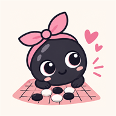

# Go Girls\* Timer

*A Go Girls\* App by Sina* 🖤

A Go clock for your phone, lying next to the board.

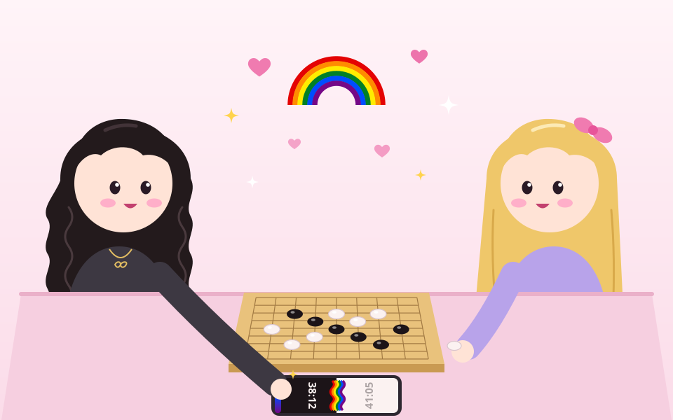

**Open it: https://sinalaura.github.io/go-timer**

## Two ways to use it

**1. In the browser:** open the link above on your phone. Nothing to install. When a game starts, it goes full screen (on Android).

**2. As an app:** add it to your phone's home screen. Then it has its own icon, always opens full screen, and works without internet once it's been opened.

- **Android:** open the browser's menu **⋮** (in Chrome at the top right, in Brave at the bottom right), then tap **Install app**, **Add to home screen** or **Install and create shortcut**, whichever your browser offers.
- **iPhone (Safari):** tap the share button, then **Add to Home Screen**.

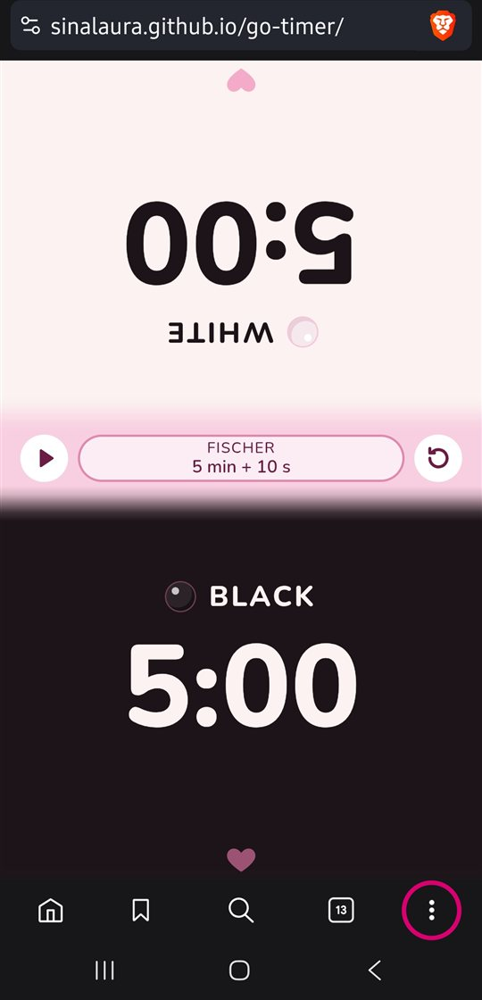&nbsp;&nbsp;&nbsp;&nbsp;&nbsp;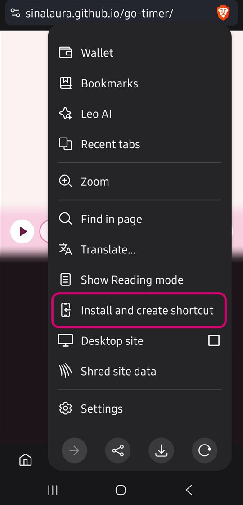

Both are the same timer, and changes reach both by themselves.

## How to use

- Tap White's half or the play button **▶** in the middle to start Black's clock. After your move, tap your own half.
- During a game, tap the pause button or the box in the middle to pause and see the statistics. Tap a half to see a chart of the time per move. When paused, three buttons slide out: **▶** continues the game, the power button ends it (it asks first), and the stopwatch lets you add or take away time for each player, or periods in byo-yomi.
- Between games, tap the box in the middle to change the time setting. It also shows how long a game will probably take, for a 19×19, 13×13 or 9×9 board.
- Leaving the app during a game pauses the clock.

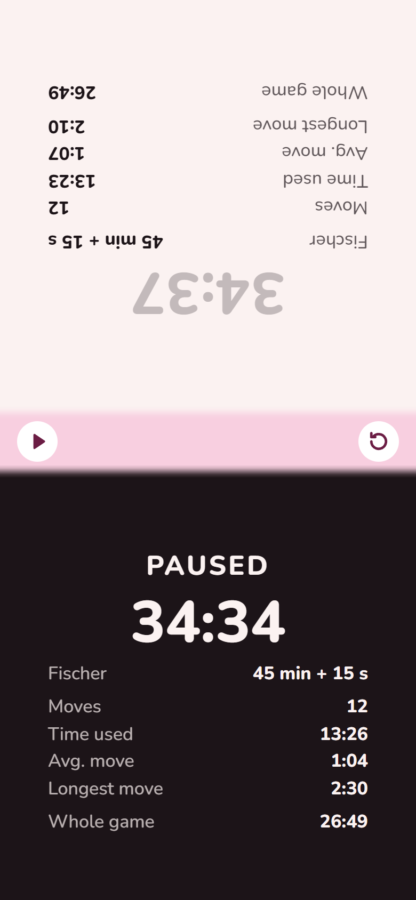&nbsp;&nbsp;&nbsp;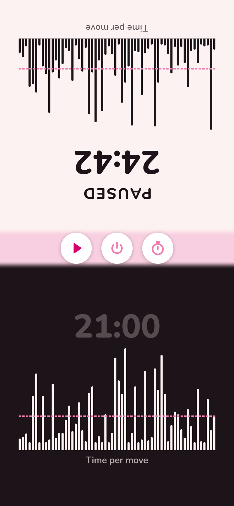&nbsp;&nbsp;&nbsp;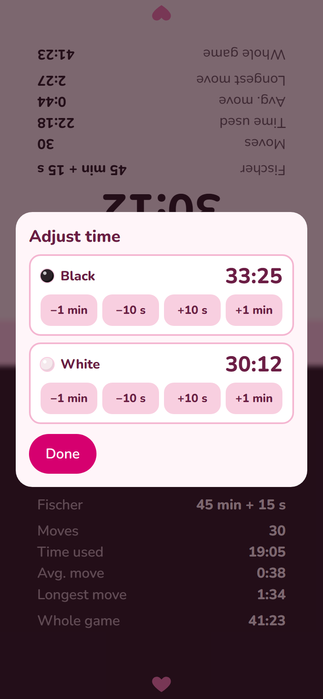&nbsp;&nbsp;&nbsp;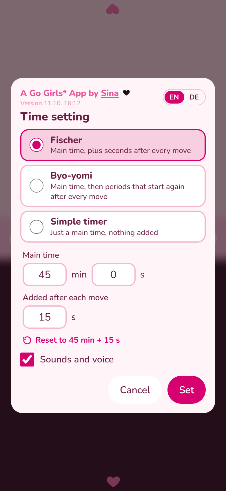

## Time settings

- **Fischer:** a main time, plus seconds after every move. Default: 45 min + 15 s.
- **Byo-yomi:** a main time, then periods that start again after every move. Default: 30 min + 5 × 30 s.
- **Simple timer:** just a main time.

Under 10 seconds the half turns pink and a soft chime sounds. When time runs out, a voice says who lost. In English or German.

🤫 Easter egg (spoiler)

 

During a game, tap the little heart on the running clock. Here are three of the colour themes; the last one is yours to find.

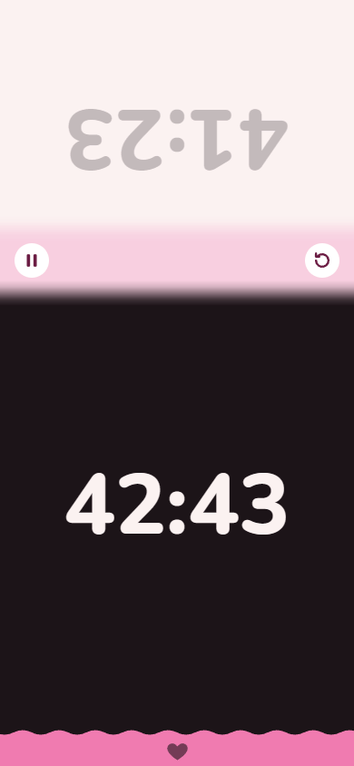&nbsp;&nbsp;&nbsp;&nbsp;&nbsp;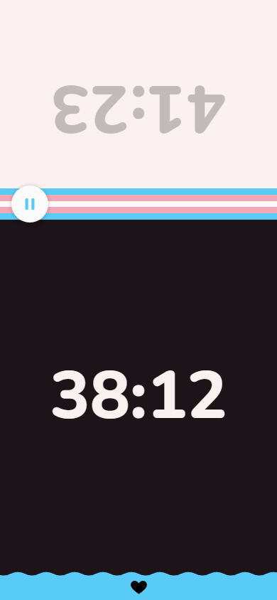&nbsp;&nbsp;&nbsp;&nbsp;&nbsp;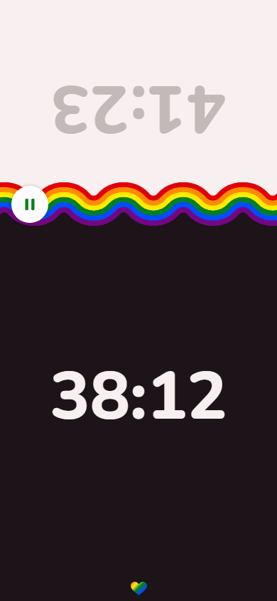

## How it's built

One `index.html` file, with no framework, no build step and no server. Built by Sina with [Claude](https://claude.com/claude-code) in October 2026: the first version in one day, then polished, about 15 hours over three days in all. Her first app.

## Licence

[MIT](LICENSE). The embedded Nunito font is under the SIL Open Font License.
