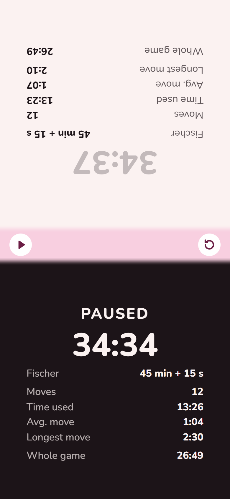
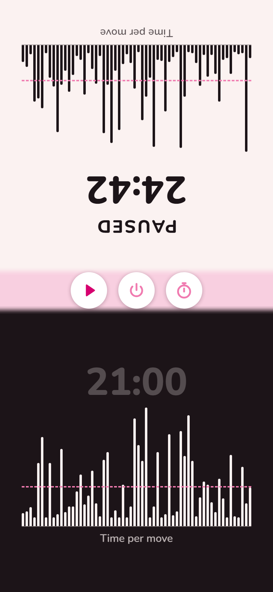
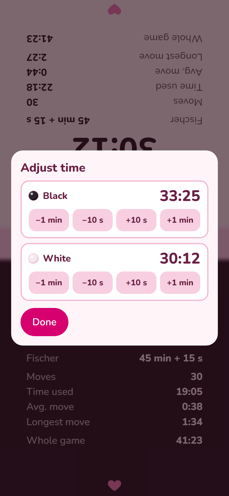
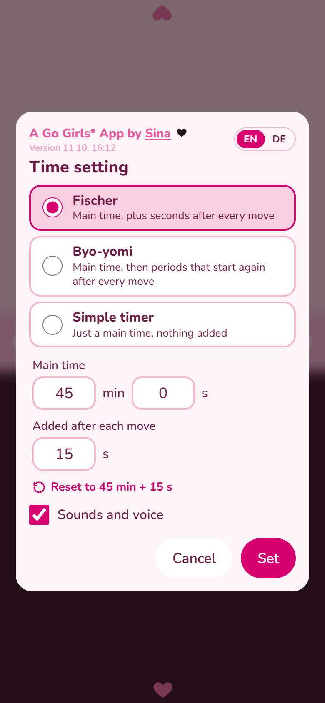
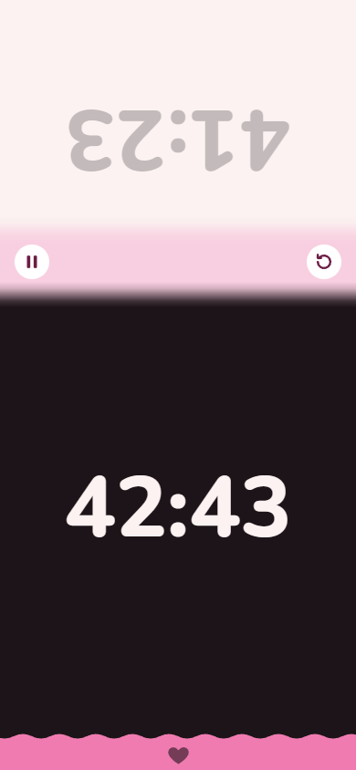
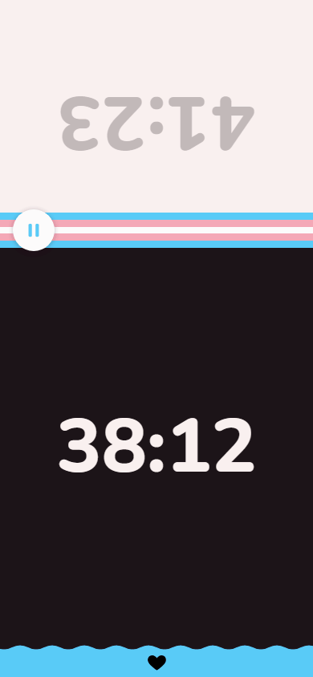
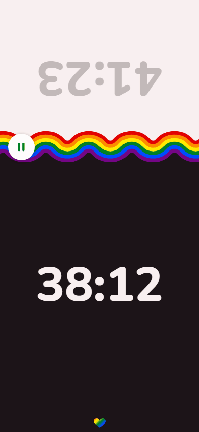

# Go Girls\* Timer

*A Go Girls\* App by Sina* 🖤

A Go clock for your phone, lying next to the board.

**Android: [get it on Google Play](https://play.google.com/store/apps/details?id=io.github.sinalaura.gotimer)**

**Or open it in the browser: https://sinalaura.github.io/go-timer**. On an iPhone, tap the share button in Safari, then **Add to Home Screen**: it then has its own icon, opens full screen and works without internet.

It is the same timer everywhere, and changes reach all of them by themselves.

&nbsp;&nbsp;&nbsp;&nbsp;&nbsp;&nbsp;&nbsp;&nbsp;&nbsp;

## Time settings

- **Fischer:** a main time, plus seconds after every move. Default: 45 min + 15 s.
- **Byo-yomi:** a main time, then periods that start again after every move. Default: 30 min + 5 × 30 s.
- **Simple timer:** just a main time.

Under 10 seconds the half turns pink and a soft chime sounds. When time runs out, a voice says who lost. In English or German.

🤫 Easter egg (spoiler)

 

During a game, tap the little heart on the running clock. Here are three of the colour themes; the last one is yours to find.

&nbsp;&nbsp;&nbsp;&nbsp;&nbsp;&nbsp;&nbsp;&nbsp;&nbsp;&nbsp;

## Found a bug or have an idea?

Write to [sinadenzel@googlemail.com](mailto:sinadenzel@googlemail.com) (there is a **Feedback** link in the app's time settings too), or start a [discussion](https://github.com/SinaLaura/go-timer/discussions) here on GitHub. English or German is fine.

## How it's built

One `index.html` file, with no framework, no build step and no server. Built by Sina with [Claude](https://claude.com/claude-code), starting in October 2026: the first version took one day. Her first app.

## Licence

[MIT](LICENSE). The embedded Nunito font is under the SIL Open Font License.
